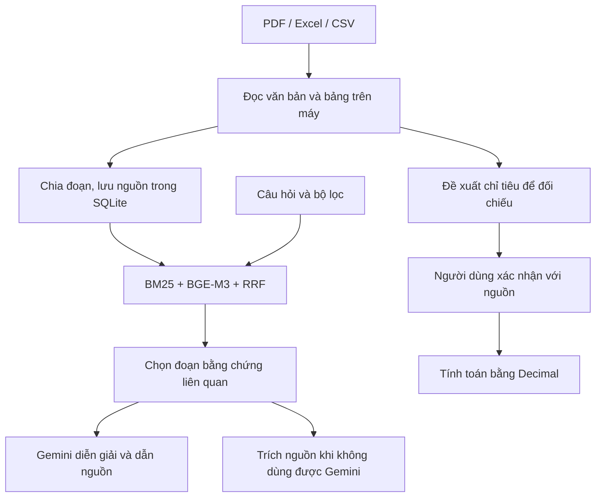

# FinLens

**Trợ lý RAG phân tích báo cáo tài chính tiếng Việt, với nguồn để đối chiếu và phép tính có thể kiểm tra.**

FinLens hỗ trợ nhập báo cáo, tìm bằng chứng, giải thích chính sách kế toán và so sánh các chỉ tiêu tài chính. Ứng dụng chạy trên máy cá nhân, có giao diện web tiếng Việt. Phần tìm kiếm và tính toán có thể dùng mà không cần API key; phần diễn giải bằng mô hình sử dụng Gemini API.

## Tính năng

- **Nhập tài liệu:** PDF từ máy hoặc URL HTTPS; Excel `.xlsx` và CSV với cấu hình sheet, cột chỉ tiêu, năm, đơn vị và cách viết số. Giao diện có hàng đợi nhập nhiều tệp.
- **Đọc báo cáo trên máy:** trích văn bản, nhận diện trang cần OCR Việt–Anh, xử lý bố cục và đọc kiểm tra bảng số liệu. Giữ tệp gốc để đối chiếu.
- **Tìm bằng chứng:** BM25 kết hợp embedding BGE-M3 và Reciprocal Rank Fusion; xếp lại theo dòng tài chính hoặc chính sách kế toán. Lọc doanh nghiệp, năm, phạm vi hợp nhất/riêng và các trang được chọn trước khi tìm kiếm.
- **Trả lời có nguồn:** Gemini nhận câu hỏi cùng các đoạn liên quan; mỗi ý phải dẫn ID nguồn hợp lệ. Giao diện cho mở trang PDF hoặc dòng/ô bảng nguồn.
- **Tính toán từ số liệu đã xác nhận:** đề xuất chỉ tiêu để người dùng kiểm tra, sau đó tính chênh lệch, tăng trưởng và một số tỷ số bằng số học xác định.
- **Dự phòng và xuất kết quả:** chuyển model theo cấu hình, ghi lịch sử lần gọi, trả về đoạn nguồn khi dịch vụ lỗi; xuất Markdown/JSON kèm nguồn và cảnh báo.

## Cách hoạt động



Gemini không đọc toàn bộ báo cáo cho mỗi câu hỏi. Bộ đọc xử lý báo cáo trước, lưu các đoạn và tìm phần liên quan khi có câu hỏi. Các phép tính từ chỉ tiêu đã xác nhận được xử lý riêng, không nhờ mô hình tự tính.

Bộ chia đoạn mặc định dùng khoảng 1.600 ký tự với phần chồng lấn 200 ký tự. Truy xuất kết hợp tối đa 60 ứng viên từ mỗi phương án, hợp nhất tối đa 120 ứng viên rồi chọn các đoạn trả về; benchmark sử dụng top 5. Đây là xếp hạng bằng quy tắc, chưa phải reranker được huấn luyện riêng.

## Công nghệ

| Thành phần | Sử dụng |
| --- | --- |
| Backend | Python 3.11+, FastAPI, Uvicorn, Pydantic |
| Giao diện | HTML, CSS, JavaScript thuần |
| Dữ liệu | SQLite, PDF/tệp gốc trên đĩa |
| PDF và OCR | PyMuPDF, dữ liệu Tesseract `eng`/`vie` |
| Bảng tính | openpyxl và bộ đọc CSV |
| Embedding | BGE-M3 qua Ollama cục bộ |
| Diễn giải | Gemini API qua HTTPX |
| Kiểm thử | unittest, kiểm thử tích hợp và bộ câu hỏi có nhãn nguồn |

Không cần Node.js để chạy ứng dụng. Node chỉ được dùng trong CI để kiểm tra cú pháp JavaScript. Ollama phục vụ embedding; dự án không còn chế độ chat Qwen/local LLM.

## Cài đặt và chạy thử

Các lệnh dưới đây dùng **PowerShell trên Windows**. Bộ phụ thuộc đã được kiểm tra cục bộ với Python 3.13.5; yêu cầu tối thiểu của gói là Python 3.11.

### 1. Tạo môi trường

```powershell
git clone https://github.com/cuong897/finlens-rag.git
Set-Location finlens-rag
py -3 -m venv .venv
.\.venv\Scripts\python.exe -m pip install -r requirements-tested.txt
.\.venv\Scripts\python.exe -m pip install --no-deps -e .
```

### 2. Chạy demo không cần API key

Trên bản clone mới, tạo cấu hình từ mẫu rồi nạp dữ liệu giả lập:

```powershell
Copy-Item .env.example .env
.\.venv\Scripts\python.exe -m finlens seed --env-file .env
.\.venv\Scripts\python.exe -m finlens serve --env-file .env
```

Mở **[http://127.0.0.1:8000](http://127.0.0.1:8000)**. Chọn dữ liệu demo, doanh nghiệp **An Phát Demo**, năm **2023 và 2024**, rồi thử:

> So sánh doanh thu thuần năm 2023 và 2024.

Kết quả tăng trưởng doanh thu demo là **25,00%**, tính trên máy. Dữ liệu này là giả lập và được gắn nhãn trên giao diện.

Cấu hình `.env.example` dùng tìm kiếm từ khóa và trích nguồn, không gọi Gemini hoặc tải mô hình. Sau khi cài thư viện, chế độ này có thể chạy ngoại tuyến. Nếu đã có `.env`, hãy sửa tệp đang dùng thay vì chép đè khóa/cấu hình hiện có.

### 3. Bật tìm kiếm ngữ nghĩa và Gemini

Trên Windows, chuẩn bị Ollama cùng embedding:

```powershell
.\.venv\Scripts\python.exe scripts/setup_ollama.py
.\.venv\Scripts\python.exe -m finlens prepare-embeddings
```

Lần đầu cần Internet để tải runtime/model. Công cụ thiết lập runtime yêu cầu ít nhất **10 GiB đĩa trống** và kiểm tra checksum. Nếu đã chạy Ollama tại `http://127.0.0.1:11434`, có thể bỏ bước thiết lập runtime. Trên hệ điều hành khác, cần tự cài và khởi động Ollama trước khi dùng embedding.

Mở `.env`, cấu hình theo [mẫu Gemini](config/gemini.env.example):

| Biến | Ý nghĩa |
| --- | --- |
| `FINLENS_PROVIDER` | `gemini` để dùng diễn giải; `extractive` để chỉ trích nguồn |
| `GEMINI_API_KEY` | Khóa Gemini API của project trong Google AI Studio |
| `FINLENS_CHAT_MODEL` | Model ưu tiên mà project của bạn được phép gọi |
| `FINLENS_FALLBACK_MODELS` | Các model dự phòng, phân cách bằng dấu phẩy; để trống để tắt |
| `FINLENS_EMBED_MODEL` | `bge-m3:latest` để dùng embedding cục bộ |
| `OLLAMA_BASE_URL` | Mặc định `http://127.0.0.1:11434` |
| `FINLENS_DATA_DIR` | Mặc định `data` |

Mẫu Gemini chứa cấu hình đã dùng trong các lượt thử của dự án. Hãy kiểm tra model ID và quyền sử dụng trong project của bạn; model cấu hình không đồng nghĩa model đang sẵn sàng phục vụ. Hạn mức và chi phí phụ thuộc tài khoản/project, FinLens không bảo đảm API miễn phí.

```powershell
.\run-gemini.cmd
```

Hoặc chạy trực tiếp:

```powershell
.\.venv\Scripts\python.exe -m finlens gemini --env-file .env
```

Lệnh khởi động chuẩn bị embedding và chỉ mục trước khi nhận câu hỏi. Chỉ mục chưa sẵn sàng thì hệ thống có thể dùng BM25. Biến môi trường đã đặt trong shell được ưu tiên hơn `.env`.

### 4. Chuẩn bị OCR nếu dùng PDF scan

```powershell
.\.venv\Scripts\python.exe -m finlens prepare-ocr --env-file .env
```

Nếu PDF đã được nhập trước khi cập nhật bộ đọc, xử lý lại và lập lại chỉ mục:

```powershell
.\.venv\Scripts\python.exe -m finlens reprocess --env-file .env
.\.venv\Scripts\python.exe -m finlens index --env-file .env
```

Cần cấu hình `FINLENS_EMBED_MODEL=bge-m3:latest` và khởi động Ollama để chạy `index`. `reprocess` cập nhật văn bản/chunk theo từng tài liệu, làm mất hiệu lực vector cũ, giữ tệp gốc và các chỉ tiêu đã xác nhận. Có thể sao lưu kho trước bằng lệnh `backup` ở phần dưới.

## Sử dụng với báo cáo thật

1. Vào **Kho tài liệu**, nhập PDF từ máy/URL hoặc chọn bảng Excel/CSV. Kiểm tra doanh nghiệp, kỳ báo cáo và phạm vi hợp nhất/riêng.
2. Với Excel/CSV, chọn sheet, dòng tiêu đề, cột chỉ tiêu và các cột năm; kiểm tra đơn vị và cách viết số trước khi nhập.
3. Chọn doanh nghiệp, năm và phạm vi rồi đặt câu hỏi, chẳng hạn: “Nguyên tắc ghi nhận doanh thu bán hàng là gì?” hoặc “Vì sao chi phí lãi vay tăng?”.
4. Mở nguồn để kiểm tra nội dung. Khi cần so sánh số liệu, dùng phần **Chỉ tiêu xác nhận** để đối chiếu đề xuất với PDF hoặc ô bảng rồi xác nhận.
5. Xuất kết quả Markdown/JSON nếu cần lưu lại câu hỏi, phạm vi, công thức và nguồn.

**Giới hạn nhập:** PDF tối đa 32 MB và 250 trang/tệp; Excel/CSV tối đa 20 MB. Bảng tính hiện dành cho dạng mỗi chỉ tiêu một dòng, mỗi năm một cột; chưa hỗ trợ `.xls`/`.xlsm`. Công thức Excel không được tự tính thành số liệu xác nhận. Nhập cùng tệp với cùng metadata/cấu hình được nhận diện trùng.

## Dự phòng và phạm vi dữ liệu

- Chuỗi Gemini có tối đa ba model, giới hạn mỗi lần gọi tối đa 10 giây trong ngân sách toàn chuỗi 30 giây. Một số lỗi nội dung được phép sửa tối đa một lần cho toàn chuỗi, vẫn dùng chung ngân sách thời gian.
- Lỗi dịch vụ/quota dẫn tới thời gian tạm nghỉ. Phản hồi “không đủ bằng chứng” hợp lệ được giữ nguyên; không tiếp tục đổi model chỉ để tìm câu trả lời khẳng định.
- Khi Gemini không phục vụ được, giao diện có thể trả các đoạn nguồn liên quan, giữ câu qua xuống dòng và điều kiện đi kèm. Đây là bằng chứng để đối chiếu, không phải đáp án AI đã xác nhận.
- Đọc tệp, OCR, embedding, lưu trữ và tính toán chạy trên máy. Khi bật Gemini, **câu hỏi cùng các đoạn bằng chứng được gửi tới Google**. Nhập tài liệu không tự gửi toàn bộ PDF cho Gemini.
- Khóa API nằm ở phía máy chủ trong `.env` hoặc biến môi trường. `.env`, `data/`, `artifacts/` và các tài liệu làm việc được Git bỏ qua; README này được theo dõi riêng để hiển thị trên GitHub.

## Kết quả thực nghiệm

Kết quả cập nhật đến **09/11/2026**, gắn với bản mã `04c9e29`. **289 kiểm thử tự động đã đạt trong lần kiểm tra cục bộ được lưu.** Đây là số đo đã ghi nhận, không phải bảo đảm mọi môi trường đều cho cùng kết quả.

| Bộ truy xuất | Số câu | Recall@5 | MRR@5 | Đủ toàn bộ bằng chứng trong top 5 |
| --- | ---: | ---: | ---: | ---: |
| SAB / MWG / BCM / VNM | 200 | 98,25% | 0,9650 | 177/200 |
| BMP / DPM / GMD / REE — hồi quy | 200 | 100% | 0,9652 | 200/200 |

Trên bộ gần đây, số mốc đối chiếu không khớp OCR giảm từ **20 xuống 6**; số câu đủ bằng chứng tăng từ **166 lên 177/200**. Các câu có dùng lại mốc số liệu, nên đây không phải tỷ lệ lỗi ký tự OCR. Recall@5 chấm trang nguồn chuẩn; “đủ bằng chứng” yêu cầu các chuỗi đối chiếu có mặt trong đoạn tìm được. Cả hai đều **không phải độ chính xác câu trả lời**.

Lượt đo đáp án dự kiến 40 câu bị gián đoạn: đã chạy **12/40**, nhận **6 phản hồi hợp lệ** gồm 5 đáp án và 1 từ chối; 6 trường hợp còn lại gặp lỗi dịch vụ/cooldown. **28 câu chưa chạy**, nên chưa có kết quả chất lượng toàn bộ 40 câu. Một lượt kiểm tra riêng câu MWG từng thiếu điều kiện đã trả lời đủ điều kiện chung và điều kiện bán hàng; không dùng lượt riêng đó thay thế các kết quả lỗi trước.

Các báo cáo/câu hỏi trên đã được sử dụng trong quá trình sửa hệ thống. Nhãn và việc chấm do cùng trợ lý thực hiện, chưa được thẩm định độc lập. Vì vậy, cần gọi đây là **kết quả development/hồi quy**, không phải bằng chứng về khả năng tổng quát hóa trên tập test chưa từng xem hoặc SLA của Gemini.

Các bản ghi có trong repository:

- [Kết quả OCR, đáp án và kiểm tra bản phát hành](finlens/fixtures/excerpt_repair_result_20261109.json)
- [Lượt đo đáp án bị gián đoạn và kết quả truy xuất](finlens/fixtures/ocr_completeness_result_20261109.json)
- [Bộ 200 câu SAB/MWG/BCM/VNM](finlens/fixtures/holdout_retrieval_20261101.json)
- [Bộ 40 câu kiểm tra đáp án](finlens/fixtures/holdout_answers_20261101.json)
- [Bộ 200 câu hồi quy BMP/DPM/GMD/REE](finlens/fixtures/benchmark_development_v3_200.json)

Tên tệp lịch sử có chữ `holdout` không làm các nguồn đã dùng để sửa hệ thống trở thành tập test độc lập lần nữa. Các tệp kết quả chứa đường dẫn/checksum của bản ghi trên máy đo; PDF, cơ sở dữ liệu và báo cáo thô trong `data/`/`artifacts/` không được đóng gói trong bản clone.

## Kiểm thử và đo lại

Kiểm thử tự động và smoke test, không cần Gemini API key:

```powershell
.\.venv\Scripts\python.exe -m unittest discover -s tests -v
.\.venv\Scripts\python.exe -m finlens evaluate --output-dir artifacts/smoke
```

Ví dụ dựng kho riêng và đo bộ 200 câu hồi quy từ báo cáo công khai:

```powershell
$env:FINLENS_EMBED_MODEL = 'bge-m3:latest'
.\.venv\Scripts\python.exe -m finlens prepare-embeddings
.\.venv\Scripts\python.exe -m finlens prepare-ocr --data-dir data/retrieval-demo
.\.venv\Scripts\python.exe -m finlens benchmark-import --data-dir data/retrieval-demo --reports-file finlens/fixtures/benchmark_reports_v3.json
.\.venv\Scripts\python.exe -m finlens index --data-dir data/retrieval-demo
.\.venv\Scripts\python.exe -m finlens evaluate-retrieval --data-dir data/retrieval-demo --cases-file finlens/fixtures/benchmark_development_v3_200.json --output-dir artifacts/retrieval-demo
```

Cần Ollama/BGE-M3 đã sẵn sàng. Lệnh nhập tải các PDF trong registry và kiểm tra checksum; nếu nhà phát hành đổi tệp, cần đối chiếu lại nguồn. Phép đo retrieval dùng embedding cục bộ, không gọi Gemini. Đọc lại tài liệu với phiên bản parser hiện tại có thể cho kết quả khác snapshot lịch sử.

Các script kiểm tra đáp án thật cần API key và có thể dùng hạn mức của project. Một số script trong `scripts/` là quy trình cho một thí nghiệm đã đóng băng, cần các snapshot cục bộ tương ứng và chủ động từ chối ghi đè kết quả cũ.

## Sao lưu

```powershell
.\.venv\Scripts\python.exe -m finlens backup --data-dir data --destination artifacts/backups/finlens-snapshot
.\.venv\Scripts\python.exe -m finlens restore --backup-dir artifacts/backups/finlens-snapshot --destination artifacts/restored-data
```

Đích phải là thư mục mới. Bản sao chứa SQLite và các tệp gốc được tham chiếu, có kiểm tra checksum; không bao gồm `.env` hoặc runtime/model. Khôi phục tạo kho riêng, không ghi đè kho đang dùng.

## Cấu trúc mã nguồn

```text
finlens/
  api.py, cli.py          API và lệnh chạy
  engine.py              Điều phối trả lời và dự phòng
  ingest.py, pdf_text.py  Nhập và đọc bố cục PDF
  ocr.py, ocr_quality.py  OCR cục bộ và kiểm tra bảng
  retrieval.py           BM25, dense và RRF
  financial_retrieval.py  Xếp hạng dòng tài chính
  accounting_policy.py   Nhận diện và xếp hạng chính sách kế toán
  providers.py           Gemini và embedding Ollama
  grounding.py           Kiểm tra một số lỗi diễn giải vượt nguồn
  excerpts.py            Giữ đoạn nguồn khi dịch vụ sinh lỗi
  finance.py, store.py    Tính toán và lưu trữ
  static/                Giao diện web
  fixtures/              Dữ liệu demo, nhãn và kết quả được lưu phiên bản
config/                  Cấu hình mẫu
scripts/                 Công cụ chuẩn bị dữ liệu và đánh giá
tests/                   Kiểm thử tự động
```

## Giới hạn hiện tại

- Ứng dụng dành cho sử dụng cục bộ một người dùng; chưa có cơ chế tài khoản/phân quyền cho triển khai công khai nhiều người dùng.
- OCR vẫn có thể sai chữ số, dấu, cột năm hoặc đơn vị. Đề xuất số liệu cần được đối chiếu trước khi xác nhận.
- Kiểm tra ID nguồn và một số dạng mất điều kiện không chứng minh mọi suy luận của mô hình đều đúng. Đoạn trích dự phòng vẫn có thể chứa nội dung ít liên quan.
- Chưa hoàn tất benchmark nội dung trên tập mới được chấm độc lập; độ ổn định Gemini trong các lượt gần đây còn hạn chế.
- Chưa có luồng hỏi đáp hình ảnh/biểu đồ chuyên biệt; không thể thay thế việc đọc và đánh giá báo cáo gốc.
