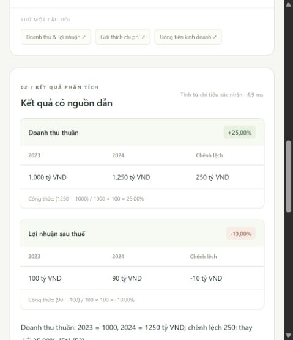

# Báo cáo kiểm tra — 27/10/2026

## Cập nhật sau thử nghiệm Ollama

Kiểm tra tự động hiện tại: **35/35 đạt**; smoke giả lập: **24/24 đạt**. Bản Ollama 0.40.11 chính thức được kiểm tra checksum, chạy local với cloud tắt. BGE-M3 đã tạo 12 embedding thật cho demo. Kiểm tra chat Qwen3 4B qua HTTP lần đầu đạt 2/6 điều kiện; các phản hồi sai định dạng đã bị chặn và chuyển về trích nguồn.

Adapter đã được sửa sang JSON schema với ID nguồn riêng và kiểm tra lại bằng mock. Chưa kiểm tra chat thật lần nữa vì người dùng đổi sang API miễn phí. Dừng tải Qwen3.5; chưa có key/chưa gọi Gemini hoặc Groq. Các kết quả bên dưới là snapshot bàn giao MVP trước bước thử Ollama.

## Môi trường đã thực thi

Windows, Python 3.13.5; FastAPI 0.136.1, Uvicorn 0.47.0, httpx 0.28.1, PyMuPDF 1.28.2, Pydantic 2.11.7. Phiên bản trực tiếp được lưu trong `requirements-tested.txt`.

## Kết quả

| Kiểm tra | Kết quả thực tế |
| --- | --- |
| `python -m unittest discover -s tests -v` | **28/28 đạt** |
| `node --check finlens/static/app.js` | Đạt |
| `python -m finlens evaluate` | **24/24 câu giả lập đạt** |
| Đóng gói wheel, không tải dependencies | Đạt, `artifacts/finlens-0.1.0-py3-none-any.whl` |
| Kiểm tra nội dung wheel | Có đầy đủ giao diện và fixtures |
| Trình duyệt thật, màn hình hẹp | Các luồng liệt kê dưới đây đạt |

Test tự động bao gồm PDF có văn bản → tải lên → xác nhận hai kỳ → tính tăng trưởng → thu hồi xác nhận → từ chối phép tính thiếu dữ liệu. Cũng kiểm tra PDF lỗi/không có văn bản, nhập trùng, đường dẫn, metadata, số âm/0, đơn vị, tiền tệ, nguồn mâu thuẫn, mẫu số, cấu hình AI và fallback.

Adapter mô hình được kiểm tra bằng `httpx.MockTransport` và provider giả lập để kiểm soát đầu vào/đầu ra. **Chưa chạy embedding/chat thật**, vì máy hiện tại chưa có Ollama được phát hiện. Chưa có API trả phí được cấu hình.

## Trình duyệt

- Nạp trang, hiện 6 tài liệu/2 doanh nghiệp/30 chỉ tiêu giả lập.
- Chạy so sánh doanh thu và lợi nhuận 2023–2024: +25% và −10%.
- Bấm nguồn F2: mở đúng báo cáo 2024, trang 1; chuyển tiếp đến thuyết minh trang 2.
- Xem kho 6 tài liệu và bảng 30 chỉ tiêu; biểu mẫu xác nhận bị vô hiệu hóa đúng khi chưa có PDF của người dùng.
- Hỏi giải thích chi phí: trích đúng câu về nguyên vật liệu/lãi vay từ trang 2. Đã loại đoạn tiêu đề bảng không đủ liên quan.
- Đổi năm bộ lọc: kết quả và nguồn cũ được xóa.

Luồng upload/xác nhận/thu hồi được kiểm tra tự động qua API, chưa thao tác hộp chọn tệp của hệ điều hành qua trình duyệt. Chưa kiểm thử bố cục desktop bằng ảnh chụp; giao diện có breakpoint tương ứng.

Ảnh chụp kết quả đang chạy:

## Đọc đúng kết quả đánh giá

Xem [bản Markdown](EVALUATION.md) và [snapshot JSON](evaluation-snapshot.json). Bộ smoke có 24 câu được thiết kế cùng fixture, không phải test set độc lập. 7 câu truy xuất có một trang nguồn chuẩn mỗi câu, chỉ 2 trang trong mỗi tài liệu mẫu; vì vậy Recall@5 và MRR@5 bằng 1.0 **không chứng minh hiệu quả trên PDF thật**.

Độ trễ snapshot được đo trong tiến trình, không gồm HTTP, trình duyệt hoặc mô hình. Để báo cáo đồ án cần dữ liệu thật, gán nhãn độc lập, đánh giá nhiều nguồn/đơn vị/phiên bản, người đánh giá nội dung và thử nghiệm mô hình thực tế.

## Kiểm tra chưa thực thi

- CI GitHub: workflow đã viết, chưa chạy do repository chưa có remote.
- Linux/Python 3.11: có trong ma trận CI dự kiến, chưa chạy trên máy hiện tại.
- Tập 15 báo cáo doanh nghiệp thật, OCR, reranker, embedding/chat thật và tải nhiều người dùng.
